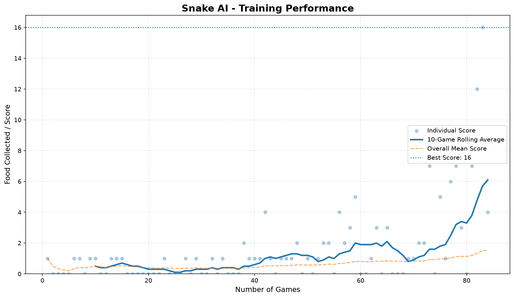

# 🐍 Snake AI – Deep Q-Learning

An AI-powered Snake Game built using **Python, Pygame, and Deep Reinforcement Learning**. The project uses a Deep Q-Network (DQN) to train an intelligent agent that learns to play Snake through trial and error, improving its decision-making over multiple games.

## 🚀 Project Overview

This project implements a Reinforcement Learning agent that learns to navigate the Snake environment, collect food, avoid collisions, and maximize its score.

Instead of following predefined rules, the agent learns optimal actions through rewards and penalties.

## 🧠 Key Features

- **Deep Q-Learning:** Uses a neural network to predict the value of possible actions.
- **Experience Replay:** Stores past experiences and learns from batches of previous interactions.
- **Epsilon-Greedy Strategy:** Balances exploration and exploitation during training.
- **Short-Term & Long-Term Training:** Updates the model using immediate and replayed experiences.
- **Model Checkpoints:** Supports saving and resuming training.
- **Training Visualization:** Tracks scores and average performance over time.
- **GPU Support:** Can use CUDA-enabled PyTorch when a compatible GPU setup is available.

## 🏗️ Model Architecture

The Deep Q-Network uses the following architecture:

| Layer | Neurons |
|---|---:|
| Input Layer | 11 |
| Hidden Layer | 256 |
| Output Layer | 3 |

The agent receives an 11-feature state representation and predicts Q-values for three possible actions.

## 📊 Training Progress

The following graph illustrates the agent's training performance:



## 🛠️ Tech Stack

- **Language:** Python
- **Game Environment:** Pygame
- **Deep Learning:** PyTorch
- **Numerical Computing:** NumPy
- **Visualization:** Matplotlib

## 📁 Project Structure

```text
Snake-AI-Deep-Q-Learning/
│
├── assets/
│   └── training_progress.png
│
├── model/
│
├── agent.py
├── game.py
├── helper.py
├── model.py
├── arial.ttf
│
├── requirements.txt
├── .gitignore
└── README.md
```

## ⚙️ Installation & Setup

**1. Clone the repository**

```bash
git clone https://github.com/YOUR_USERNAME/Snake-AI-Deep-Q-Learning.git
cd Snake-AI-Deep-Q-Learning
```

**2. Create a virtual environment**

```bash
python -m venv venv
```

Activate it:

Windows:
```bash
venv\Scripts\activate
```

**3. Install dependencies**

```bash
pip install -r requirements.txt
```

**4. Run the project**

```bash
python agent.py
```

## 🎯 Learning Objective

The objective is to develop an intelligent agent capable of learning effective movement strategies through reinforcement learning, improving its performance over successive training episodes.

## 🔮 Future Improvements

- Improve training efficiency and convergence.
- Experiment with different neural network architectures.
- Add more advanced reinforcement learning algorithms.
- Build a real-time training analytics dashboard.
- Evaluate performance across multiple training runs.

## 👨‍💻 Author

**Naman Gambhir**

Engineering Student | AI & Machine Learning Enthusiast

---

⭐ If you find this project interesting, consider giving the repository a star!